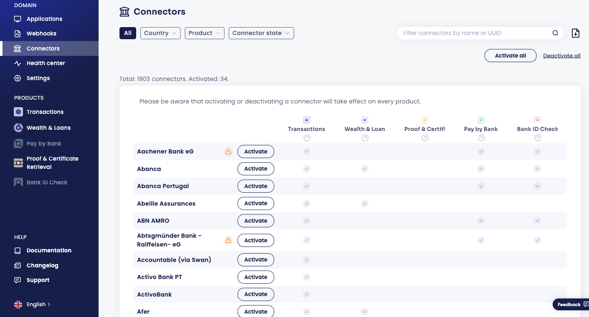
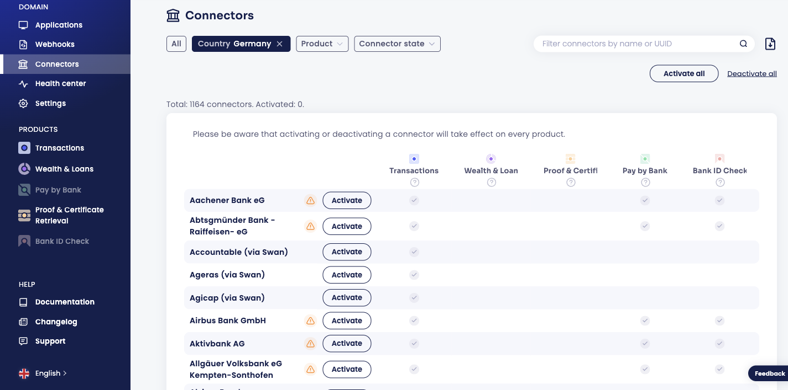

This page helps you choose which banks Freenary offers when it uses Powens. In Powens, each bank is a **connector**: the Powens module that signs in to one bank and reads its accounts. A Powens domain lists every connector Powens has, but only the ones you **activate** in the Powens console reach Freenary. Freenary never activates a connector for you, so a bank you did not activate is missing from **Connect your bank** and **Search banks…** cannot find it.

## Before you start

- Freenary uses Powens as its bank provider. See [Configure Powens](configure-powens.md).
- You can sign in to [the Powens console](https://console.powens.com) with the account that owns the domain set in **Powens domain** or `POWENS_DOMAIN`.
- You know which banks your members use. Freenary lists every activated connector, whatever country each member picked. See [How the bank list is built](../explanation/bank-list.md).

## Steps

1. In the Powens console, open your domain, then select **Connectors** in the left menu, under **DOMAIN**. The line above the table counts the connectors of the domain and the activated ones, for example **Total: 1903 connectors. Activated: 34.**

   

2. To find the banks of one country, select **Country** and pick it. The count line now counts that country only. It can read **Activated: 0**: no bank of that country reaches Freenary yet.

   

3. Find a bank by name in **Filter connectors by name or UUID**, then select **Activate** next to it. The button then reads **Activated**. Repeat for every bank your members use. **Activate all** activates every connector the filters show.

   The console warns: **Please be aware that activating or deactivating a connector will take effect on every product.** A connector you activate is on for every Powens product of the domain, not only for the bank data Freenary reads.

4. To take a bank out of the list, select **Activated** next to it, or **Deactivate all**.

> **TODO (unverified):** what happens to an existing Freenary connection, and its next sync, after you deactivate its connector.

## Check that it works

1. In Freenary, open **Settings** › **Bank accounts** and select **Connect a bank**, or reach **Connect your bank** during onboarding.
2. Type the bank name in **Search banks…**. The bank you activated is in the list, with a **Connect** button.

Freenary keeps the list it got from Powens for one hour, so a change in the console shows in Freenary within the hour, or at once after a server restart.

## If something goes wrong

- **No banks available** in **Connect your bank**. No connector is activated on the domain. Activate the banks your members use (step 3).
- **No banks match your search** for a bank that exists in the console. Its connector is not activated. Activate it.
- An activated connector is still missing. Freenary leaves out connectors that Powens marks as hidden or restricted, and connectors that offer neither the **Transactions** product (`bank`) nor the **Wealth & Loans** product (`wealth`).
- **Could not load banks** in **Connect your bank**. Powens did not answer the request for the connector list. The server log shows `Bank institutions unavailable`. See [Configure Powens](configure-powens.md#if-something-goes-wrong).

## Related

- [Configure Powens](configure-powens.md)
- [How the bank list is built](../explanation/bank-list.md)
- [Connect your first bank](../tutorials/connect-your-first-bank.md)
