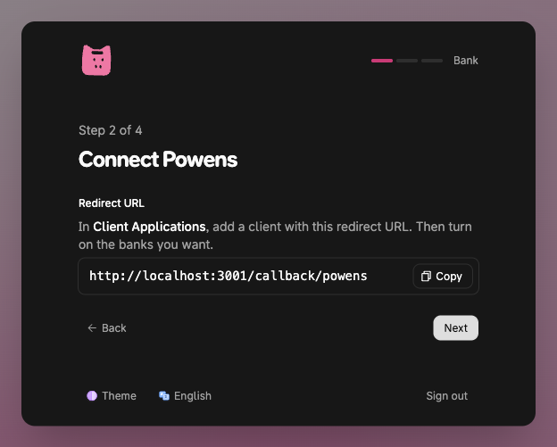
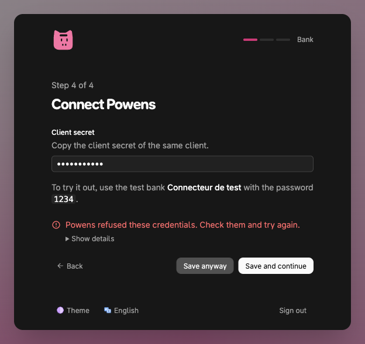

This page connects Freenary to Powens, the bank provider that links members' bank accounts so their transactions arrive on their own. You can enter the Powens credentials in the app or put them in `.env`. If both hold a value for the same setting, the value in `.env` wins.

## Before you start

- Freenary runs, and you can sign in as the operator. The operator is the first account created on the instance, and only the operator sees the setup screen and the **Services** list in **Settings**.
- You know the web address of your instance, for example `http://localhost:3001`. After a member connects a bank, Powens sends them back to that address followed by `/callback/powens`.
- You have a Powens console account, or you create one in step 3. The app links to [the Powens registration page](https://console.powens.com/auth/register).

## Steps

### In the app

1. Open the setup screen. It opens on its own after the first sign-in, on the **Bank** step. On an instance that is already set up, open **Settings** › **Services** instead, find **Bank provider**, and select **Set up** or **Change**.
2. Select **Powens** (marked **Recommended**), then select **Continue**.
3. On **Step 1 of 4**, create a free account in the Powens console, then a domain, and enter the domain name in **Powens domain**, for example `acme-sandbox`. Enter the name alone, without `https://`. Select **Next**.
4. On **Step 2 of 4**, select **Copy** next to **Redirect URL**. In the Powens console, open your domain, select **Applications**, then **Add an application**. Enter a **Name**, paste the URL into **Redirect URIs**, select **Save**, then **Exit**. Then select **Connectors** and select **Activate** next to each bank your members use: Freenary only lists the connectors you activate, as [Choose which banks members can connect with Powens](choose-powens-banks.md) explains. Select **Next** in Freenary. [Connect your first bank](../tutorials/connect-your-first-bank.md#3-enter-the-powens-details) shows each console screen.

   

5. On **Step 3 of 4**, paste the **Client ID** of the application you just added into **Client ID**. Select **Next**.
6. On **Step 4 of 4**, paste the **Client secret** of the same application (select **Show** in the console to see it) into **Client secret**.
7. Select **Save and continue** on the setup screen, or **Save** in **Settings**. Freenary first tests the credentials, then saves them.
8. Apply the change. On the setup screen, go on to the **Done** step and select **Finish setup**. In **Settings**, select **Apply now** in the **Restart to apply your changes** notice. The page shows **Applying your settings…** while the server restarts.

### In `.env`

1. In the Powens console, under **Applications**, add an application whose redirect URI is your web address followed by `/callback/powens`, for example `http://localhost:3001/callback/powens`. Freenary builds this URL from `CORS_ORIGIN`, which `docker-compose.yml` sets to `http://localhost:3001` when `.env` leaves it out.
2. Add the three Powens values to `.env`:

   ```dotenv
   POWENS_DOMAIN=acme-sandbox
   POWENS_CLIENT_ID=12345678
   POWENS_CLIENT_SECRET=paste-the-client-secret-here
   ```

   `BANKING_PROVIDER` defaults to `powens`, so you can leave it out. `POWENS_DOMAIN` also accepts a value that ends with `.biapi.pro`. See [Configuration](../reference/configuration.md#bank-providers).

3. Recreate the server container so it reads the new values:

   ```bash
   docker compose up -d
   ```

## Check that it works

1. Open **Settings** › **Services**. The **Bank provider** row reads **Configured · Powens** when you saved the values in the app, or **Set by your server · Powens** when they come from `.env`.
2. For values from `.env`, select **View**, then **Test connection**. The test logs in to Powens with the credentials, creates a throwaway Powens user and deletes it again. A working setup shows **Powens is ready**.
3. Connect a bank as described in [Connect your first bank](../tutorials/connect-your-first-bank.md). On a Powens sandbox domain, use the test bank **Connecteur de test**; its sign-in page accepts any credentials.

## If something goes wrong

- **Enter the domain name alone, without http:// or https://.** You typed a URL in **Powens domain**. Enter the name only, for example `acme-sandbox`.
- **Powens refused these credentials. Check them and try again.** Powens answered the test with an error. Check that the client ID and the client secret belong to the same client of that domain. **Show details** holds the answer from Powens. **Save anyway** saves the values without the test.

  

- **Unable to reach Powens. Check the address and your network, then try again.** The server could not reach `https://<domain>.biapi.pro/2.0`. Check the domain name, and check that the server container can reach the internet.
- **Your server's environment sets this provider.** `.env` sets `BANKING_PROVIDER` to another provider. Change or remove that line in `.env`, then run `docker compose up -d`.
- **The server did not restart** and **It did not answer within one minute.** The server did not come back after **Apply now** or **Finish setup**. Run `docker compose ps` and `docker compose logs server`, then `docker compose up -d`, and select **Try again**.
- The server log shows `Powens refused to release the user the check created: <status>. Delete it in the console.` The test could not delete its throwaway user. Delete that user in the Powens console.
- A server log line contains `Powens is not configured`. One of the three Powens values is missing. Set all three.

## Related

- [Choose which banks members can connect with Powens](choose-powens-banks.md)
- [Configure Enable Banking](configure-enable-banking.md)
- [Where settings come from](../explanation/settings-sources.md)
- [Configuration](../reference/configuration.md#bank-providers)
