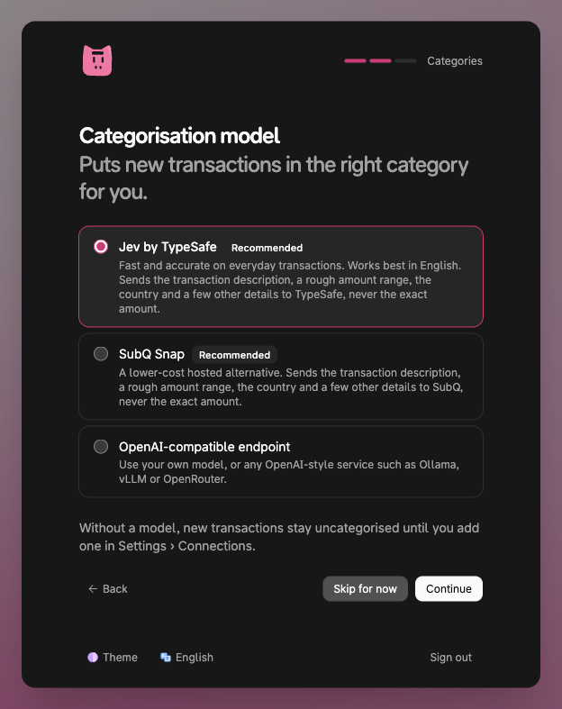

This page connects a classifier, a model that picks a category for a merchant that your corrections, the merchant dictionary and the built-in rules do not know. Without one, such transactions stay uncategorised. You can choose the classifier on the setup screen, in **Settings**, or in `.env`. If both hold a value for the same setting, the value in `.env` wins. [How transactions get categories](../explanation/categorisation.md) explains where the classifier fits.

## Before you start

- Freenary runs, and you can sign in as the operator. The operator is the first account created on the instance, and only the operator sees the setup screen and the **Services** list in **Settings**.
- To use **Settings**, you finished your own onboarding by connecting a bank: until then every page of the app, including **Settings**, sends you back to onboarding. See [First run and the operator](../explanation/first-run-and-operator.md#onboarding). The `.env` way works at any time.
- You have picked a classifier. The app offers three:
  - **Jev by TypeSafe**, hosted. It needs an API key from the [TypeSafe quickstart](https://docs.typesafe.ai/introduction/quickstart).
  - **SubQ Snap**, hosted. It needs an API key from the [SubQ Decisions API quickstart](https://docs.subq.ai/endpoints/decisions-api/). SubQ keeps requests for up to 60 days unless you ask for zero retention.
  - **OpenAI-compatible endpoint**, your own model or a service such as Ollama, vLLM or OpenRouter. It needs the endpoint URL with its version path and the model ID.
- The classifier receives the transaction description, a rough amount range, the country and a few other details, never the exact amount.

  > **TODO (unverified):** how you create an API key in the TypeSafe and SubQ dashboards.

## Steps

### In the app

1. Open the setup screen and go to the **Categories** step. On an instance that is already set up, open **Settings** › **Services** instead, find **Categorisation model**, and select **Set up** or **Change**.
2. Select **Jev by TypeSafe**, **SubQ Snap** or **OpenAI-compatible endpoint**, then select **Continue**.

   

3. Fill in the fields:
   - For **Jev by TypeSafe**, keep `jev-latest` in **Model** and paste your key in **API key**.
   - For **SubQ Snap**, keep `subq-snap-1.1` in **Model** and paste your key in **API key**.
   - For **OpenAI-compatible endpoint**, enter **Endpoint URL** and **Model**. Open **More options** for **API key** if the endpoint needs one. For Ollama, the screen suggests `http://ollama:11434/v1` and `qwen3:4b-instruct-2507-q4_K_M`. Freenary's Compose files do not start Ollama, so you run it yourself where the server container can reach it. Freenary measures the confidence of an answer from the log probabilities (`logprobs`) the endpoint returns. An endpoint that returns none gets a confidence of `0.5` for every answer.
4. Select **Save and continue** on the setup screen, or **Save** in **Settings**. Freenary first sends the classifier a sample transaction, then saves the settings.
5. Apply the change. On the setup screen, go on to the **Done** step and select **Finish setup**. In **Settings**, select **Apply now** in the **Restart to apply your changes** notice. The page shows **Applying your settings…** while the server restarts.

### In `.env`

1. Add the classifier to `.env`. For Jev by TypeSafe:

   ```dotenv
   TRANSACTION_CLASSIFIER=system-one
   TRANSACTION_CLASSIFIER_URL=https://api.typesafe.ai/v1/systemone
   TRANSACTION_CLASSIFIER_MODEL=jev-latest
   TRANSACTION_CLASSIFIER_API_KEY=paste-your-key-here
   ```

   For SubQ Snap, use the same lines with `https://api.subq.ai/v1/systemone` and `subq-snap-1.1`. For an OpenAI-compatible endpoint, set `TRANSACTION_CLASSIFIER=llm`, the URL with its version path, and the model; Freenary adds `/chat/completions` to the URL. The app lists the following choices only when one of them is already selected, with a **Legacy** badge, so you set them in `.env`: `system-one` with any other server that answers the `/v1/systemone` request (the app's **Laya**, **Von** and **Another System One server** choices are such servers), and `zero-shot` for a Hugging Face zero-shot classification server.

2. Optionally, add a fallback classifier. Freenary asks it when the first one gives no answer or answers with a confidence under `TRANSACTION_CLASSIFIER_ESCALATE_BELOW`, `0.85` by default, and keeps the answer with the higher confidence. The fallback exists in `.env` only.

   ```dotenv
   TRANSACTION_CLASSIFIER_FALLBACK=llm
   TRANSACTION_CLASSIFIER_FALLBACK_URL=https://openrouter.ai/api/v1
   TRANSACTION_CLASSIFIER_FALLBACK_MODEL=qwen/qwen3-8b
   TRANSACTION_CLASSIFIER_FALLBACK_API_KEY=sk-or-...
   ```

   `TRANSACTION_CLASSIFIER_TIMEOUT_MS`, `10000` by default, sets how long Freenary waits for either classifier. See [Configuration](../reference/configuration.md#categorisation) for the temperature settings.

3. Recreate the server container so it reads the new values:

   ```bash
   docker compose up -d
   ```

## Check that it works

1. In **Settings** › **Services**, the **Categorisation model** row reads **Configured ·** and the classifier name, or **Set by your server ·** and the name when the values come from `.env`.
2. Open **Settings** › **Categories** and, under **Re-categorise transactions**, select **Re-categorise all**. The progress shows **Sorting transactions into categories**. This sorts again every transaction whose category you did not set yourself, without asking your banks for new transactions.
3. Check that transactions that were uncategorised now carry a category, and that the server log has no `[categorisation] classifier` warnings:

   ```bash
   docker compose logs server | grep '\[categorisation\]'
   ```

## If something goes wrong

- The server stops at start with `TRANSACTION_CLASSIFIER=<protocol> requires TRANSACTION_CLASSIFIER_URL to be set.` or the same line for `TRANSACTION_CLASSIFIER_MODEL`. Add the missing value. The same applies to the `TRANSACTION_CLASSIFIER_FALLBACK_` values.
- The server stops at start with `TRANSACTION_CLASSIFIER_FALLBACK needs TRANSACTION_CLASSIFIER to name the classifier asked first.` Set `TRANSACTION_CLASSIFIER` too, or remove the fallback.
- The server stops at start with `… names the protocol and the model that answer first, so both slots would share one cache row.` The fallback repeats the first classifier. Use another model or protocol.
- The log shows `[categorisation] classifier <protocol> answered nothing within <ms>ms for one merchant`. The classifier is too slow. Raise `TRANSACTION_CLASSIFIER_TIMEOUT_MS`, up to `120000`.
- The log shows `[categorisation] classifier <protocol> failed for one merchant: …`. The call failed. The detail names the cause, such as a refused key or an unreachable host.
- **Jev by TypeSafe refused these credentials. Check them and try again.**, or the same for another classifier. The endpoint refused the key. Check it. **Save anyway** saves without the test.
- **Unable to reach OpenAI-compatible endpoint. Check the address and your network, then try again.**, or the same for another classifier. Check the URL, and that the server container can reach it.

## Related

- [How transactions get categories](../explanation/categorisation.md)
- [Where settings come from](../explanation/settings-sources.md)
- [Configuration](../reference/configuration.md#categorisation)
