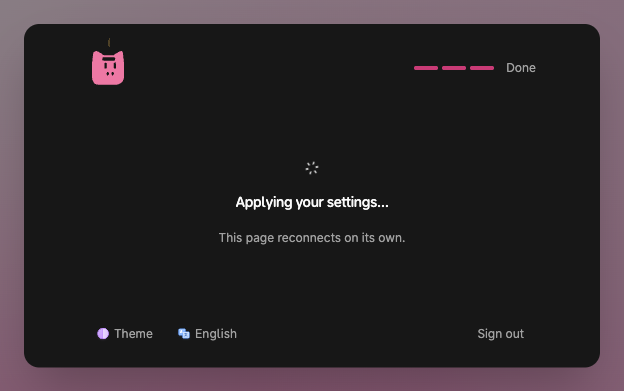

This page helps you find why a Freenary stack does not start, why the browser shows an error, why a bank stops importing, or why sign-in fails. You find the service that fails, read its log, and match the message to one of the cases below.

## Before you start

- You are in the folder that holds `docker-compose.yml` and `.env`.
- You know the four services of the stack: `postgres`, the database; `migrate`, which applies the database migrations once and exits; `server`, the API server; and `web`, the web app that the browser talks to.

## Steps

1. List the containers and their state:

   ```bash
   docker compose ps -a
   ```

   `postgres`, `server` and `web` should read `Up … (healthy)`, and `migrate` should read `Exited (0)`. A service that reads `(unhealthy)`, `Exited (1)` or `Created` is the one to look at. `Created` means it never started, because a service it waits for failed first.

2. Read the log of the first service that failed, such as the server:

   ```bash
   docker compose logs server
   ```

   The first lines come from the start. After them, the server writes one JSON line per request.

3. Find the message in the cases below.

## Check that it works

Every service is healthy, and the API answers through the web app:

```bash
curl http://localhost:3001/api/auth/ok
```

The answer is `{"ok":true}`. Use your public address instead of `http://localhost:3001` if you set one.

## If something goes wrong

### The stack does not start

- `docker compose up -d` stops with `required variable POSTGRES_PASSWORD is missing a value: Set POSTGRES_PASSWORD in .env`, or the same line for `BETTER_AUTH_SECRET`. `.env` lacks the value, or `.env` is not in the current folder. Add the value, for example `BETTER_AUTH_SECRET=` followed by the output of `openssl rand -hex 32`. See [Configuration](../reference/configuration.md#core-and-secrets).
- It stops with `Bind for 127.0.0.1:3001 failed: port is already allocated`. Another program uses port `3001`. Set another port in `.env`, and the addresses that go with it:

  ```dotenv
  WEB_PORT=127.0.0.1:3101
  BETTER_AUTH_URL=http://localhost:3101
  CORS_ORIGIN=http://localhost:3101
  ```

  With `Bind for 127.0.0.1:5432 failed`, another PostgreSQL uses port `5432` on the host. Set `POSTGRES_PORT=55432`, or any free port.

- It stops with `service "migrate" didn't complete successfully: exit 1`, and `docker compose logs migrate` shows `Error: P1000: Authentication failed against database server`. `POSTGRES_PASSWORD` changed after the database volume was created, and PostgreSQL keeps the first password. Put the original value back.
- It stops with `dependency failed to start: container freenary-server-1 exited (1)`. The server stopped during its start. Find the line that starts with `error:` in `docker compose logs server`:
  - `error: Invalid environment variables` follows a list headed `❌ Invalid environment variables:`. Each entry names a variable in `path` and the problem in `message`, for example `path: [ "BETTER_AUTH_SECRET" ]` with `message: "Too small: expected string to have >=32 characters"`, or `path: [ "TRUSTED_PROXIES", 0 ]` with `message: "Invalid input"`. Fix that variable in `.env`. The "Absent or wrong" column of [Configuration](../reference/configuration.md) says what each variable accepts.
  - `error: The API (…) and the web app (…) are on different hosts, so the session cookie needs SameSite=None — which browsers reject over plain HTTP. …`. `BETTER_AUTH_URL` and `CORS_ORIGIN` have different hostnames on `http://`. Give both the same address, or serve `BETTER_AUTH_URL` over HTTPS.
  - `error: AUTH_COOKIE_DOMAIN (…) is not a parent of both … and …`, `… ends in a dot …` or `… is a single label …`. Fix `AUTH_COOKIE_DOMAIN` as the message says, or remove it.
  - `error: EMAIL_PROVIDER=smtp requires SMTP_HOST to be set.` and similar lines name the value a provider needs. Add it.
- It stops with `dependency failed to start: container freenary-server-1 is unhealthy`. The server runs, but its health check, a request to `http://localhost:3000/` inside the container, fails. One cause is a `PORT` line in `.env`: the server then listens on another port. Remove `PORT` from `.env`.

After each fix, run `docker compose up -d`.

### The server logs a warning

- `TRUSTED_PROXIES is not set. If a reverse proxy sits in front of the web app, every visitor counts as the proxy's address and shares one sign-in rate limit: …`. Without a proxy, as on `http://localhost:3001`, nothing is wrong. Behind a proxy, set `TRUSTED_PROXIES` to its address range. See [Use an existing reverse proxy](use-an-existing-reverse-proxy.md).
- `[auth] BETTER_AUTH_URL (http://…) is plain HTTP, so the session cookie has no Secure flag …`. Expected on `http://localhost`. On a public address, serve Freenary over HTTPS and set `BETTER_AUTH_URL` and `CORS_ORIGIN` to the `https://` address.
- `This instance has no operator yet. The first account to sign in at http://localhost:3001 becomes the operator.` No account exists yet. Open that address and create the first account. If the address is wrong, fix `CORS_ORIGIN`. See [First run and the operator](../explanation/first-run-and-operator.md).
- `This instance has no operator yet. Sign in at … and enter SETUP_TOKEN on the setup screen to become the operator.` `SETUP_TOKEN` is set and no account has entered it yet. Sign in, and enter the value from `.env` on **Claim this instance**.
- `The stored value of … does not open with the current BETTER_AUTH_SECRET.` `BETTER_AUTH_SECRET` changed since the operator saved settings in the app. See [Back up and restore](back-up-and-restore.md#if-something-goes-wrong).

### Other devices cannot open Freenary

The root `docker-compose.yml` publishes the web app on `127.0.0.1:3001`, so only the machine that runs Docker can open it. A tunnel such as `tailscale serve` or a reverse proxy on that machine reaches it as it is.

To open it to your network instead, add two lines to `.env`. `SETUP_TOKEN` takes a long random value, such as the output of `openssl rand -hex 16`:

```dotenv
SETUP_TOKEN=4c8e…(32 characters)
WEB_PORT=3001
```

Set `BETTER_AUTH_URL` and `CORS_ORIGIN` to the address the other devices use, such as `http://192.168.1.20:3001`, and run `docker compose up -d`. Docker writes its own firewall rules, so a host firewall such as `ufw` does not close a published port. With `SETUP_TOKEN` set, a stranger who signs up first cannot become the operator: the setup screen asks for the token. See [First run and the operator](../explanation/first-run-and-operator.md).

### The browser shows an error

- The page or an API request answers `Bad Gateway`, and `docker compose logs web` shows `The API server at http://server:3000/… did not answer:` followed by the reason, such as `no answer within 9 seconds`. The web app could not reach the server, which is stopped, restarting or unhealthy. Run `docker compose ps -a` and follow the server case above.
- The setup screen shows **Configuration problem** and **The stored configuration did not load:** followed by a reason. The settings saved in the app fail the configuration check, so the server ignores all of them and runs on `.env` alone. The reason names the variable. Set that variable in `.env`, where it wins over the saved value, and run `docker compose up -d`. See [Where settings come from](../explanation/settings-sources.md#settings-load-once-at-start).

### The server does not come back after saving settings

- After **Finish setup** or **Apply now**, the page shows **The server did not restart** and **It did not answer within one minute.** Applying settings makes the server process exit so that it starts again with them. In `docker-compose.yml` and `deploy/docker-compose.yml`, `restart: unless-stopped` starts it again. Run `docker compose ps -a`: if `server` reads `Exited`, run `docker compose up -d --wait`, then select **Try again**. If it reads `(unhealthy)` or keeps restarting, read `docker compose logs server` and match the message to the cases above.

  

### A bank stops importing

- The bank in **Settings** › **Bank accounts** reads **Reconnect to resume importing**. Its consent expired or was revoked, or the bank asks for the account holder. Syncs skip this bank. Its owner selects **Reconnect** and approves the access again. The accounts the bank returns keep their transactions. An account left out of the new consent keeps its history and is no longer synced, and an account the bank never returned before is added.
- A notice reads **Couldn’t sync** with the name of the bank, and the row does not ask to reconnect. The failure can be temporary, such as a timeout, so the next sync tries this bank again. The reason is in `docker compose logs server`.

### Sign-in fails

- Sign-in or sign-up shows the message **Something went wrong. Try again.**, and `docker compose logs server` shows `ERROR [Better Auth]: Invalid origin: http://127.0.0.1:3001`. The browser uses another address than `CORS_ORIGIN`, here `127.0.0.1` instead of `localhost`. Open Freenary at the address in `CORS_ORIGIN`, or set `CORS_ORIGIN` and `BETTER_AUTH_URL` to the address you use. With `deploy/docker-compose.yml`, set `FREENARY_URL`.

## Related

- [Configuration](../reference/configuration.md)
- [Compose files](../reference/compose-files.md)
- [Use an existing reverse proxy](use-an-existing-reverse-proxy.md)
