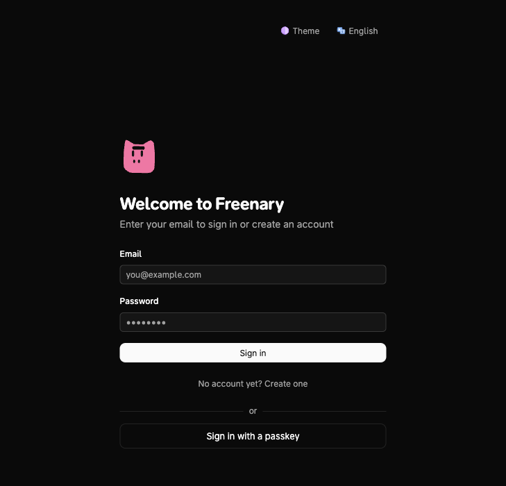
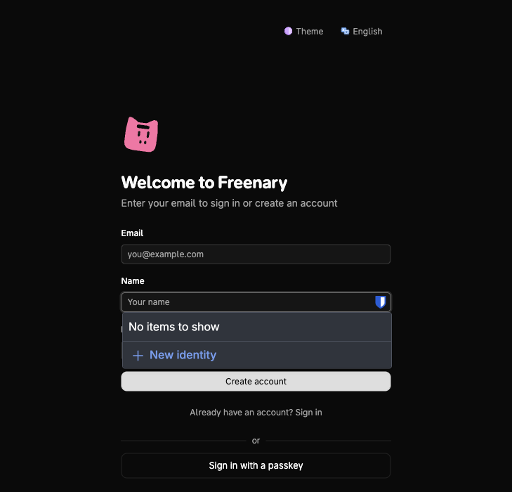
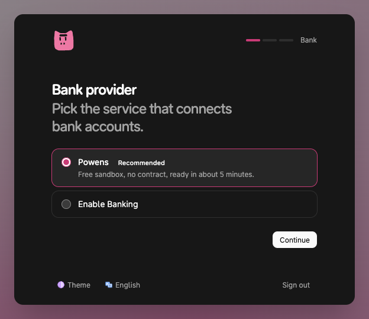

In this tutorial you start Freenary on your own computer, check that every part works, and create the first account. It takes about 10 minutes, most of it spent downloading images.

You end with Freenary running at `http://localhost:3001` and your account signed in on the setup screen. This setup is for trying Freenary on one machine. To put it on a server with a domain name and HTTPS, follow [Self-host on a server](self-host-on-a-server.md) afterwards.

## Before you start

You need:

- **Docker with Docker Compose v2.** On macOS, install Docker Desktop. On Linux, install Docker Engine and its Compose plugin from [docs.docker.com](https://docs.docker.com/engine/install/). On Windows, install Docker Desktop with its WSL 2 backend.
- **A Unix shell with `curl` and `openssl`.** macOS and Linux have both. On Windows, run every command of this tutorial in a WSL 2 terminal (for example Ubuntu from the Microsoft Store), not in PowerShell or Command Prompt: the commands use Bash syntax. This tutorial was tested on macOS only.

  > **TODO (unverified):** run this tutorial on Linux and on Windows with WSL 2.

- **Free ports.** Port `3001` for the web app, and port `5432` on `127.0.0.1` for the database. [Step 3](#3-create-the-env-file) shows how to pick other ports.
- **About 1.5 GB of disk space** for the images. On a test machine, the running stack used about 450 MB of memory.

Check Docker before you go on:

```bash
docker compose version
```

The output starts with `Docker Compose version v2` or a higher version number. If you see `docker: 'compose' is not a docker command`, Compose v2 is missing: install the Compose plugin, then check again. The older `docker-compose` command (with a hyphen) is not enough.

## 1. Create a folder

Every command in this tutorial runs in this folder.

```bash
mkdir -p ~/freenary
cd ~/freenary
```

## 2. Download the Compose file

```bash
curl -fsSLo docker-compose.yml https://raw.githubusercontent.com/suiramdev/freenary/main/docker-compose.yml
```

This file describes four services:

| Service | What it does |
| --- | --- |
| `postgres` | The PostgreSQL database that holds all your data. |
| `migrate` | Runs once at each start to update the database tables, then exits. |
| `server` | The API server. Nothing outside Docker can reach it directly. |
| `web` | The web app on port `3001`. It also passes API requests to `server`. |

## 3. Create the `.env` file

Compose refuses to start without two secrets: a database password and a key that signs sign-in cookies. Generate both and write them to `.env`:

```bash
cat > .env <<EOF
POSTGRES_PASSWORD=$(openssl rand -hex 16)
BETTER_AUTH_SECRET=$(openssl rand -hex 32)
EOF
```

Check the file:

```bash
cat .env
```

You see two lines with long random values:

```text
POSTGRES_PASSWORD=3f9c0d2e7a51b8c4e6f0a9d3b2c1e5f7
BETTER_AUTH_SECRET=8a1f…(64 characters)
```

Keep this file. You need the same `BETTER_AUTH_SECRET` every time you start Freenary: it also encrypts settings you save in the app. See [Back up and restore](../how-to/back-up-and-restore.md).

If port `3001` or `5432` is already in use on your computer, add one or both of these lines to `.env` with free ports:

```dotenv
WEB_PORT=127.0.0.1:3002
POSTGRES_PORT=5433
```

If you change `WEB_PORT`, also add these two lines with the same port, and use that port instead of `3001` for the rest of this tutorial:

```dotenv
BETTER_AUTH_URL=http://localhost:3002
CORS_ORIGIN=http://localhost:3002
```

## 4. Start Freenary

```bash
docker compose up -d --wait
```

The first start downloads the images, which can take a few minutes. `--wait` makes the command return only when every service is ready. When it succeeds, the last lines name each container, and the command exits without an error:

```text
 Container freenary-migrate-1 Exited
 Container freenary-server-1 Healthy
 Container freenary-postgres-1 Healthy
 Container freenary-web-1 Healthy
```

The exact layout of these lines depends on your Compose version. If the command ends with an error instead, go to [If something goes wrong](#if-something-goes-wrong).

## 5. Check that every part works

1. List the containers, including the one that has already exited:

   ```bash
   docker compose ps -a
   ```

   In the `STATUS` column, expect:
   - `postgres`, `server` and `web`: `Up … (healthy)`
   - `migrate`: `Exited (0)`. This is correct: it runs once and stops.

2. Check that the database tables were created:

   ```bash
   docker compose logs migrate
   ```

   The last line reads `All migrations have been successfully applied.` on the first start, and `No pending migrations to apply.` on later starts.

3. Check that the web app answers:

   ```bash
   curl -s -o /dev/null -w '%{http_code}\n' http://localhost:3001/login
   ```

   Expected output: `200`.

4. Check that the web app reaches the API server:

   ```bash
   curl -s http://localhost:3001/api/auth/ok
   ```

   Expected output: `{"ok":true}`.

5. Read the server log:

   ```bash
   docker compose logs server
   ```

   It contains this line:

   ```text
   This instance has no operator yet. The first account to sign in at http://localhost:3001 becomes the operator.
   ```

   The log also shows two warnings that start with `[auth] BETTER_AUTH_URL (http://localhost:3001) is plain HTTP` and `TRUSTED_PROXIES is not set`. A third one, `WARN [Better Auth]: Rate limiting could not determine a client IP`, can appear later. On your own computer you can ignore them. [Self-host on a server](self-host-on-a-server.md) deals with them.

## 6. Create the first account

The first account created on a new instance becomes the **operator**: the person who configures the instance. See [First run and the operator](../explanation/first-run-and-operator.md).

Freenary answers on this computer alone: other devices on your network cannot open it, so nobody else can create the first account. To open it to your network, see [Other devices cannot open Freenary](../how-to/troubleshoot.md#other-devices-cannot-open-freenary).

1. Open `http://localhost:3001` in your browser. You land on a page titled **Welcome to Freenary**.

   

2. Select **No account yet? Create one**. The main button changes to **Create account**.

   

3. Enter your email, your name and a password.
4. Select **Create account**.

You see the message **Account created successfully**, and the browser opens the setup screen. Its progress bar shows three steps, **Bank**, **Categories** and **Done**, and the first page is titled **Bank provider**.



## You're done

Freenary is running and you are its operator.

- To finish the setup screen and import your first transactions, follow [Connect your first bank](connect-your-first-bank.md). You need a bank provider account: a Powens sandbox is free.
- To stop Freenary, run `docker compose stop` in `~/freenary`. To start it again, run `docker compose up -d --wait`. Your data stays in a Docker volume between restarts.
- To delete everything, including all data, run `docker compose down -v`.

## If something goes wrong

- **`required variable POSTGRES_PASSWORD is missing a value: Set POSTGRES_PASSWORD in .env`** (or the same message for `BETTER_AUTH_SECRET`). `.env` is missing, is in another folder, or has an empty value. Run the commands from `~/freenary`, then redo [step 3](#3-create-the-env-file).
- **`Bind for 127.0.0.1:3001 failed: port is already allocated`** (or `127.0.0.1:5432`). Another program uses that port. Set `WEB_PORT` or `POSTGRES_PORT` as shown in [step 3](#3-create-the-env-file), then run `docker compose up -d --wait` again.
- **`dependency failed to start: container freenary-server-1 exited (1)`** or **`… is unhealthy`**. Read the server log with `docker compose logs server`. A line `Invalid environment variables` lists the setting that is wrong. A `BETTER_AUTH_SECRET` shorter than 32 characters is one example.
- **The browser shows an error when you create the account.** Check that the address in the browser is exactly the `CORS_ORIGIN` value (`http://localhost:3001` by default). `http://127.0.0.1:3001` is a different address, and the server refuses it.

[Troubleshoot](../how-to/troubleshoot.md) covers more cases.
